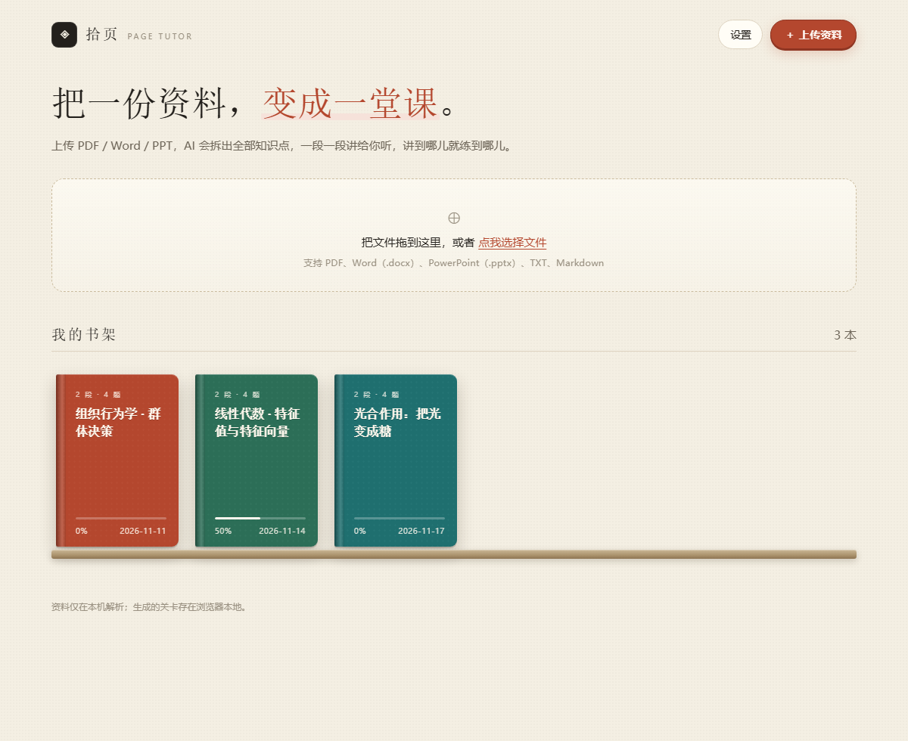
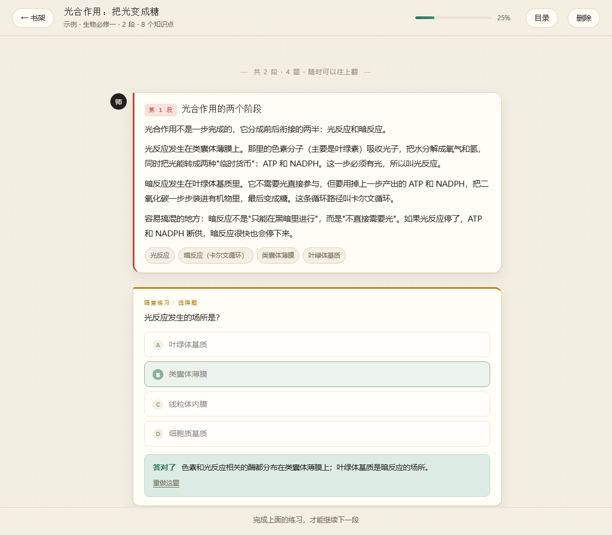
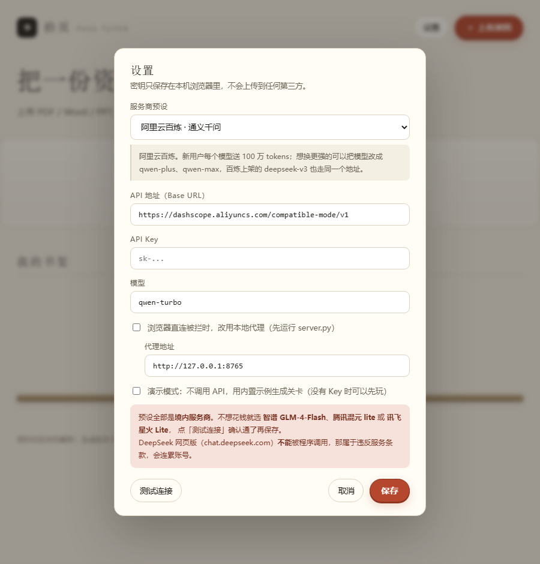

# 拾页 · PAGE TUTOR

把一份 PDF / Word / PPT 变成一关可以「聊着学」的课程：AI 拆出全部知识点，一段一段讲解，讲完就出选择题、填空题，答完继续下一段。每一份资料在书架上变成一本书，随时可以回来翻聊天记录。

`MIT License` · 纯前端无后端 · 资料只在本地解析 · 只内置境内服务商







---

## 怎么跑起来

**方式一：直接双击 `index.html`**
浏览器直连 DeepSeek 接口。实测 CORS 是通的，一般能直接用。缺点是密钥存在浏览器里。

**方式二：双击 `start.bat`（推荐）**
会启动一个本地小服务，页面和 API 请求都走本地，不存在跨域问题，也不会把 Key 暴露给第三方。需要装过 Python 3.8+。

```
python server.py            # 或者双击 start.bat
```

如果想让代理服务器替你保存 Key：

```bat
set DEEPSEEK_API_KEY=sk-xxxxxxxx
python server.py
```

---

## 第一次使用

1. 点右上角「设置」
2. **服务商预设** 选一个（不想花钱就选智谱 GLM-4-Flash / 腾讯混元 lite / 讯飞星火 Lite）
3. 填 **API Key**，点「测试连接」确认通了
4. 保存，回到首页把文件拖进虚线框 → 选参数 → 开始生成

想先不花钱试试效果：设置里勾上 **演示模式**，或者首页空书架上的「先看一个示例关卡」。

---

## 支持的文件

| 类型 | 说明 |
|---|---|
| `.pdf` | 用 pdf.js 在本地解析。**扫描版（纯图片）读不出文字**，需要先用 OCR 转一遍 |
| `.docx` | mammoth 解析。旧版 `.doc` 请先另存为 `.docx` |
| `.pptx` | 解压后逐页读文本框。旧版 `.ppt` 请先另存为 `.pptx` |
| `.txt` / `.md` | 直接读 |

解析库走 CDN（jsDelivr，失败自动切 unpkg），第一次使用需要联网。

---

## 生成一关要花多久

流程是三步，全部串行调用模型：

1. **切块提取知识点**：每 ~2800 字一次调用
2. **整理教学大纲**：把知识点去重、排顺序、分成若干小节
3. **逐小节写讲解 + 出题**：每节一次调用

一本 20 页的讲义大概 6~10 次调用、1~2 分钟。进度条和日志会实时显示每一步。

因为要「覆盖所有知识点」，长文档的调用次数会线性增长；代码里做了上限保护（最多切 34 段）。

---

## 数据存在哪

全部在浏览器 `localStorage` 里：`pt.index.v1`（书架索引）、`pt.level.<id>`（每个关卡）、`pt.settings.v1`（设置）。

- 资料原文**不会**上传到任何服务器，只有切块后的文本会发给 DeepSeek
- 换浏览器 / 清缓存会丢，重要的话自己留意
- 书架上的书悬停时右上角有删除按钮

---

## 文件结构

```
study/
├── index.html   页面结构
├── style.css    样式（纸张 / 墨 / 印刷网点质感）
├── app.js       解析、模型调用、生成流程、聊天回放
├── server.py    可选的本地代理（标准库，无依赖）
├── start.bat    一键启动
└── preview-study-*.png
```

---

## 想不花钱：可以，但别用网页版

**DeepSeek 网页版（chat.deepseek.com）不能被程序调用。** 它需要登录态、有 PoW 验证，自动化属于违反服务条款，社区里的同类工具都明确警告会导致账号限流甚至封禁。省几毛钱不值得。

> 本项目只内置**境内服务商**，不提供任何境外模型通道（OpenRouter、Gemini、Ollama 等已移除）。

正路是换一个**免费的国内 API**。设置里已经内置了预设，选好、点「测试连接」、通过就保存：

| 预设 | 免费情况 | 申请地址 |
|---|---|---|
| **智谱 GLM-4-Flash** ⭐ | 免费，中文好，当主力够用 | open.bigmodel.cn |
| **腾讯混元 hunyuan-lite** | 免费 | cloud.tencent.com/product/hunyuan |
| **讯飞星火 Lite** | 免费（Key 用 APIPassword） | xfyun.cn |
| **阿里云百炼** | 新用户每个模型送 100 万 tokens | bailian.console.aliyun.com |
| **硅基流动** | 赠送额度 + 部分模型免费 | cloud.siliconflow.cn |
| **DeepSeek 官方** | 按量计费，极便宜 | platform.deepseek.com |

注意：
- 各家免费模型清单会变，报错就去控制台看当前哪些标着「免费」
- 免费模型普遍是轻量版，生成结构化 JSON 时偶尔会格式跑偏，代码里已经做了容错解析；
  如果某一份资料反复失败，换 DeepSeek 官方或百炼上的大模型会更稳
- 阿里云百炼的 base_url 按地域区分，国内用 `https://dashscope.aliyuncs.com/compatible-mode/v1`

如果只是想先看看效果，设置里的 **演示模式** 完全不调用 API。

---

## 想换个付费模型

设置里的 **Base URL** 和 **模型** 都可以改，预设选「自定义」手动填即可。只要兼容 OpenAI 格式就能用。

---

## 已知限制

- 扫描版 PDF 不支持（没有 OCR）
- 生成过程中关掉页面会中断，已生成的部分不会保存
- 题目判分：选择题按选项下标；填空题做了去空格 / 标点 / 大小写的模糊匹配，答案过长时可能误判，可在解析里自己核对
- 单个关卡存在 localStorage，特别长的文档（几百页）可能撑爆配额

---

## License

[MIT](LICENSE)。随便用、随便改、随便分发，保留版权声明即可。
